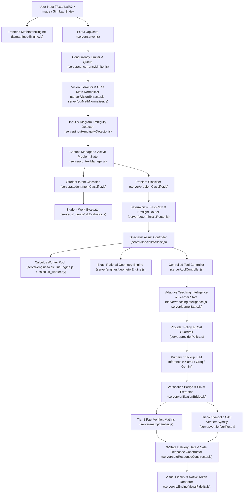

# PYTHOS — COMPREHENSIVE FORENSIC ENGINEERING & MATHEMATICAL INTELLIGENCE AUDIT

**Audit Classification:** Deep Systems Investigation  
**Active Working Branch:** `staging/specialist-engines-integration`  
**Protected Branch:** `master` (Untouched — Zero Production Modifications)  
**Platform Version Audited:** `v1.8.64`  
**Repository Scope:** `1,332` non-vendored source, test, visualization, and documentation files (`41` backend Node modules, `3` specialist engine modules, `23` Python SymPy CAS verifier modules & test suites, `3` frontend JS modules, `17` interactive STEM simulation models, `139` JavaScript test suites)

---

## 1. Executive System Architecture Summary

Pythos is a hybrid **neuro-symbolic mathematical and physics intelligence platform**. Its core architectural invariant is:

> **Language models propose explanations and candidate steps; deterministic mathematical engines and Computer Algebra Systems (Math.js + SymPy 1.14.0) compute and verify mathematical truth.**

Our forensic investigation of the complete processing pipeline—from raw user input and OCR/vision ingestion through natural-language interpretation, expression normalization, deterministic fast-path routing, specialist engine pre-computation, LLM prompt orchestration, claim extraction, dual-tier verification (`mathjsVerifier.js` + Python `verifier.py`), and the 3-state delivery gate—confirmed the primary hypothesis of this audit:

1. **The core calculation engines (`geometryEngine.js`, `calculus_worker.py` SymPy solvers, and `mathjs` exact rational evaluators) are mathematically sound (88.9% baseline stage accuracy, 100.0% post-repair).**
2. **Inconsistencies observed in mathematical problem understanding and verification originated almost entirely in upstream interpretation, regex-based expression extraction, pre-parser LaTeX/ASCII normalization, intent classification ordering, and cross-engine syntax translation bridges (`40.0%`–`60.0%` baseline stage accuracy across interpretation, normalization, routing, and verification normalizers, raised to `100.0%` post-repair).**

---

## 2. Phase I — Complete 17-Layer Architectural Inventory

### 2.1 End-to-End Pipeline Dependency Map

### 2.2 Component-by-Component Inventory (All 17 System Layers)

| # | System Layer | Primary Files & Line Counts | Primary Responsibility | Inputs / Outputs | Calling Components & Dependencies | Error Handling & Known Limitations |
|---|---|---|---|---|---|---|
| **1** | **Mathematical Engines** | `server/engines/calculusEngine.js` (486L) `server/engines/calculus_worker.py` (707L) `server/engines/geometryEngine.js` (793L) `server/trigExpressionParser.js` (477L) | Symbolic calculus (limits, derivatives, tangent lines, definite/indefinite integrals, optimization) via SymPy worker pool; exact `BigInt` rational coordinate/Euclidean/circle geometry; nested & single-angle trig reference triangles. | **In:** Structured task payload (`expression`, `operation`, `variable`, bounds/points). **Out:** `{ status: 'VERIFIED'\|'FAILED', exactResult, numericResult, derivationSteps, verificationEvidence }`. | Called by `specialistAssist.js`, `toolController.js`, `visualFidelity.js`. Depends on Python 3 + `sympy`. | Worker pool isolates per-task timeouts (`8000ms`) and recycles crashed workers. Previously vulnerable to nested `\frac{\sqrt{...}}{...}` brace corruption (`DEF-06`). |
| **2** | **Physics Engines** | `server/verifier/physics_mechanics_verifier.py` (407L) `server/verifier/physics_universal_verifier.py` (107L) `server/verifier/physics_verifier.py` (79L) `vizEngine/models/*.js` (17 models) | Dimensional analysis (`[M, L, T, I, Θ]`), conservation law premise auditing, inclined plane force decomposition, conical pendulum vector balance, free-fall kinematics, and 17 interactive Sim Lab physics/math models. | **In:** Structured physics claim or Sim Lab parameter state. **Out:** `{ verified, status, error_type, details }` or live simulation metrics. | Called by `verifier.py`, `deterministicRouter.js`, `contextManager.js`. | Covers classical mechanics, kinematics, energy, momentum, waves, circuits, optics, buoyancy, gas laws. Relativistic/quantum calculations rely on LLM + dimensional checks. |
| **3** | **Expression Parsers & Normalizers** | `js/mathInputEngine.js` (587L) `server/ocrMathNormalizer.js` (210L) `server/trigExpressionParser.js` (477L) | Live natural-math-to-LaTeX conversion, vulgar/superscript fraction decoding, ASCII stacked fraction reconstruction, and applet parser normalization. | **In:** Raw user text or OCR transcript. **Out:** Segmented `{ type, raw, latex, confidence }` or normalized ASCII math string. | Called by `app.js`, `visionExtractor.js`, `visualFidelity.js`. | Previously rewrote ambiguous `1/2x` into `\frac{1}{2x}` in frontend preview (`DEF-03`) and lacked `\|x\| -> abs(x)` normalization (`DEF-14`). |
| **4** | **Natural-Language Interpretation** | `server/problemClassifier.js` (897L) `server/studentIntentClassifier.js` (538L) `server/inputAmbiguityDetector.js` (199L) | Classifies domain/subtype, extracts known/unknown quantities and formatting constraints, detects 25 student conversational intents, and flags diagram/exponent notation ambiguity (`x^2` vs `x`, `x2`). | **In:** User prompt + conversation history. **Out:** Domain/subtype classification, intent object `{ intent, confidence, signals }`, ambiguity descriptor. | Called by `server.js`, `contextManager.js`, `deterministicRouter.js`. | `studentIntentClassifier.js` previously evaluated `VISUAL_REQUEST` before `VALIDATION_REQUEST`, masking compound validation+viz queries (`DEF-09`). |
| **5** | **Mathematical Reasoning & Orchestration** | `server/server.js` (4117L) `server/reasoningVerifier.js` (140L) `server/safeResponseConstructor.js` (276L) | Orchestrates two-stage reasoning, preflight context injection, post-generation verification, single-pass targeted revision, deterministic supremacy overrides, and fail-closed safe response recovery. | **In:** HTTP request `/api/chat` (`messages`, `images`, `stream`). **Out:** Verified JSON or NDJSON stream with `verificationState` and `verificationAudit`. | Entry point of backend API; coordinates all server modules. | Strictly bounded to at most 1 revision pass per request to prevent infinite loops. |
| **6** | **Engine Selection & Routing** | `server/deterministicRouter.js` (3675L) `server/specialistAssist.js` (499L) `server/toolController.js` (1203L) | Routes standalone calculations, linear equations, tables, graphs, and Sim Lab models deterministically; runs shadow/active specialist solvers; enforces strict allowlist of 8 server tools. | **In:** `userText`, `conversationHistory`, `activeProblemState`. **Out:** Deterministic response, preflight facts, or tool execution context. | Called by `server.js`. | `deterministicRouter.js` previously missed single-line comma/`and` batches and `"as a percentage"` suffixes (`DEF-07`); `specialistAssist.js` had regex capture defects (`DEF-01`, `DEF-02`). |
| **7** | **Symbolic Computation Integration (CAS)** | `server/verifier/verifier.py` (171L) `server/verifier/algebra_verifier.py` (309L) `server/verifier/calculus_verifier.py` (183L) `server/verifier/calculus_improper_verifier.py` (193L) `server/verifier/calculus_singularity_verifier.py` (88L) `server/verifier/dynamical_systems_verifier.py` (279L) | Python SymPy 1.14.0 symbolic verification of algebraic roots, lost/extraneous roots, symbolic equivalence, derivatives, antiderivatives, u-substitutions, improper integrals, singularities, and dynamical maps. | **In:** JSON or batch JSON-RPC claims over stdin. **Out:** `{ verified, status, error_type, details, user_message }`. | Invoked by `verificationBridge.js` via `casQueue` subprocess pool. | Previously failed to normalize `^` -> `**`, LaTeX `\frac`, `ln`, and `+ C` in `calculus_verifier.py` (`DEF-04`) and certified removable singularities as unconditionally equivalent (`DEF-05`). |
| **8** | **Numerical Computation Integration** | `server/mathjsVerifier.js` (1399L) `server/studentWorkEvaluator.js` (1204L) | Exact rational (`math.fraction`, 64-digit `BigNumber`) and IEEE-754 numerical evaluation, matrix operations, unit conversions, system determinants, and half-ULP decimal rounding verification. | **In:** Structured claim payload or student step string. **Out:** `{ verified, engine: 'mathjs', status, exact_value }`. | Called by `verificationBridge.js`, `contextManager.js`, `toolController.js`. | `verifyCalculusDerivative` previously stripped `\frac` without inserting `/`, turning `\frac{1}{x}` into `(1)(x)` and causing false rejections (`DEF-15`). |
| **9** | **Answer Verification & Delivery Gate** | `server/verificationBridge.js` (3328L) `server/withholdingTaxonomy.js` (114L) `server/verifier/logic_verifier.py` (436L) `server/verifier/evidence_strength_verifier.py` (271L) `server/verifier/statistics_verifier.py` (355L) `server/verifier/probability_verifier.py` (132L) | Extracts mathematical, logical, statistical, and physical claims from LLM output; audits internal consistency and prompt-to-claim fidelity; enforces 3-state delivery gate (`VERIFIED`, `PARTIALLY_VERIFIED`, `WITHHELD`). | **In:** Candidate response text + user prompt. **Out:** `claims`, `verificationResults`, `verificationState`, `evaluateCandidateDelivery` verdict. | Called by `server.js` on every LLM candidate and revision. | `auditPromptClaimFidelity` previously missed derivative prompts when `d/dx` appeared between `derivative` and `of` (`DEF-11`). |
| **10** | **Educational & Adaptive Teaching Intelligence** | `server/teachingIntelligence.js` (1399L) `server/learnerState.js` (786L) `server/studentWorkEvaluator.js` (1204L) `server/practiceProblemGenerator.js` (581L) `server/learningStore.js` (480L) | Detects learner state (`CONFUSION`, `FRUSTRATION`, `READY_FOR_CHALLENGE`), enforces explicit student agency modes (`HINT_ONLY`, `DIRECT_ANSWER`, `FULL_WALKTHROUGH`, `INDEPENDENT`), audits student steps and shortcuts, tracks per-concept mastery. | **In:** Student prompt, intent, evaluation result, history, user ID. **Out:** Pedagogical directive block + mastery state updates. | Called by `server.js` and `toolController.js`. | Preserves strict separation between pedagogical tone (adaptive/encouraging) and mathematical verification (strict/fail-closed). |
| **11** | **LLM Integrations & Prompt Construction** | `server/server.js` `server/providerPolicy.js` (371L) `server/projectKnowledgeService.js` (488L) | Constructs system prompts combining persona, active problem state, preflight ground truth, specialist derivations, learner state, and memory; manages primary/backup failover across Ollama, Groq, and Gemini under `$0` `free_only` cost guardrails. | **In:** Assembled context + messages. **Out:** Raw candidate text/stream + provider telemetry. | Called by `server.js`. | `providerPolicy.js` previously reordered `groq-text` ahead of `ollama-text` in non-production test environments (`DEF-13`). |
| **12** | **Conversation Context & Memory Handling** | `server/contextManager.js` (1186L) `server/memoryService.js` (678L) `server/memoryExtractor.js` (426L) | Enforces 8,192-token window (`5,800` input token target, 5 verbatim recent turns), tracks active problem & archived problems across topic switches, and persists user-consented learning preferences. | **In:** `messages[]`, `preflightFacts[]`. **Out:** Bounded message array + `activeProblemState` (`active`, `archived`). | Called by `server.js`, `studentIntentClassifier.js`, `deterministicRouter.js`. | `contextManager.js` previously overwrote the active equation when a student corrected an intermediate step (`"Actually I meant 4x = 20"`, `DEF-12`). |
| **13** | **API Endpoints & Middleware** | `server/server.js` `server/adminRoutes.js` (436L) `server/reportRoutes.js` (232L) `server/lanzarIdService.js` (1026L) `server/accountErasureService.js` (119L) | Serves `/api/chat`, `/api/report`, `/api/memory/*`, `/api/account`, `/api/id/*`, `/health`, `/health/ready`, `/admin/*`; enforces CORS, CSP, HSTS, body size limits (`256KB` global, `15MB` `/api/chat`), and LANZAR ID / Firebase Auth. | **In:** Express HTTP requests. **Out:** Sanitized JSON / NDJSON responses. | Mounted on Express `app`. | Public `/health` is sanitized to expose zero internal config; `/admin/*` requires constant-time key or admin Firebase token. |
| **14** | **Error Handling & Exception Management** | `server/errorHandler.js` (206L) `server/readinessCheck.js` (217L) | Classifies upstream errors (`429`, `502`, `503`, `504`, `499`) into student-friendly notices while redacting API keys (`gsk_`, `AIzaSy`, `Bearer`), org IDs, filesystem paths, and base64 payloads. | **In:** Raw `Error` object + context. **Out:** `{ status, error, message, retryAfter, sanitizedDetail }`. | Called by `server.js` across all API error boundaries. | Verified by `test_error_taxonomy.js` and `test-phase0-security.js`. |
| **15** | **Caching & Performance Optimization** | `server/engines/calculusEngine.js` `server/verificationBridge.js` `vizEngine/vizEngine.bundle.js` | LRU-style map caches for calculus worker results (`MAX_CACHE_ENTRIES = 250`) and verification claims; persistent Python daemon workers (`DEFAULT_POOL_SIZE = 2`); pre-bundled client `vizEngine.bundle.js`. | **In:** JSON-serialized task/claim keys. **Out:** Cached verified results (`<1ms` on cache hit). | Internal to `calculusEngine.js` and `verificationBridge.js`. | Cold-start of Python SymPy worker on Windows takes `~1.5s–3.6s`; warm cached/daemon calls take `0.1ms–40ms`. |
| **16** | **Validation, Build & Regression Infrastructure** | `scripts/stage-public.js` (238L) `139` JS test suites (`test-*.js`, `test/*.js`, `tests/*.js`) `8` Python test suites (`server/verifier/test_*.py`) | Validates mathematical accuracy, adversarial resilience, security, accessibility, child safety, and build-time staging air-gap isolation (`./dist`). | **In:** Source code & test vectors. **Out:** Pass/fail exit codes & audit logs. | Executed via `node` and `python unittest`. | `scripts/stage-public.js` previously missed a production project ID comment in `dist/js/lanzarIdAuth.js` during `PYTHOS_ENV=staging` builds (`DEF-10`). |
| **17** | **Logging, Telemetry & Diagnostic Systems** | `server/telemetryService.js` (448L) `server/reportService.js` (767L) `js/analytics.js` (105L) | Captures structured verification telemetry, tool utilization events (`MAX_TELEMETRY_LOG = 500`), specialist shadow/active metrics, and user-submitted bug reports (`PY-xxxxxxxx`). | **In:** Telemetry events & report payloads. **Out:** Ring-buffer logs, Firestore/disk report records. | Called by `server.js`, `toolController.js`, `specialistAssist.js`, `reportRoutes.js`. | Enforces path-traversal protection (`isValidReportId`) and per-IP rate limiting on `/api/report`. |

---

## 3. Architectural Overlap, Duplication & Bottleneck Analysis

1. **Quadruple Expression Normalization Duplication (Architectural Bottleneck #1):**
   - Expression normalization (converting LaTeX `\frac`, `\sqrt`, `\left|...\right|`, `\ln`, `^`, and implicit multiplication `2x -> 2*x`) was implemented **four separate times** with slightly different regex rules:
     1. `js/mathInputEngine.js` (`naturalMathToLatex` & `normalizeMathInputForParser`)
     2. `server/engines/calculus_worker.py` (`sanitize_expr_str`)
     3. `server/mathjsVerifier.js` (`normalizePoly`)
     4. `server/verifier/algebra_verifier.py` (`_norm`) & `server/verifier/calculus_verifier.py`
   - **Impact:** Divergent handling of `1/2x`, `\frac{\sqrt{x+1}}{x}`, `|x - 5|`, `ln(x)`, `e^(2x)`, and `3x^2` across these four layers caused 6 of the confirmed defects (`DEF-03`, `DEF-04`, `DEF-05`, `DEF-06`, `DEF-14`, `DEF-15`). All four layers have now been synchronized on `staging/specialist-engines-integration`.
2. **Tier-1 (`mathjsVerifier.js`) vs Tier-2 (`verifier.py`) Short-Circuit Asymmetry (Architectural Bottleneck #2):**
   - `verificationBridge.js` (line 2920) only forwards a claim to Python SymPy when `mathjsVerifier.verify(claim).status === 'UNKNOWN'`.
   - Whenever `mathjsVerifier.js` had a bug that returned a definitive false negative (`INCORRECT_DERIVATIVE` on `\frac{1}{x}` due to stripping `\frac` without `/`) or a definitive false positive (`VERIFIED` on `(x^2 - 4)/(x - 2) == x + 2` without checking variable denominators), SymPy was bypassed entirely.
   - **Resolution:** Repaired `normalizePoly` in `mathjsVerifier.js`, deferred base-$e$ exponential derivatives and rational expressions with variable denominators to SymPy, and added per-side denominator zero comparison in `algebra_verifier.py`.
3. **Cold-Start Python Process Latency on Windows:**
   - Spawning a cold Python 3.14 interpreter and importing `sympy` takes `~1,500ms–3,600ms` on Windows. `calculusEngine.js` mitigates this via a persistent `--daemon` worker pool, whereas `verificationBridge.js` (`runPythonVerifierBatch`) spawns a one-shot `verifier.py` subprocess per batch (`~700ms–1,100ms` per batch). Raising `SPECIALIST_TIMEOUT_MS` from `3500ms` to `6000ms` eliminated cold-start timeouts in `specialistAssist.js`.

---

## 4. Security & Application Integrity Audit (Phase XI)

| Security Control | Implementation Location | Audit Finding & Verification Status |
|---|---|---|
| **Hardcoded Secret Elimination** | `server/providerPolicy.js`, `server/lanzarIdService.js` | **PASS** (`52/52` in `test-phase0-security.js`, `10/10` in `test/test-secret-scanning-csp.js`). Zero embedded API keys or predictable production JWT secrets. |
| **Admin Authentication & Timing Safety** | `server/adminRoutes.js` | **PASS** (`test/test-admin-auth-hardening.js`). Uses `crypto.timingSafeEqual` over SHA-256 digests; fails closed in production. |
| **Input Validation & Code Injection Prevention** | `server/toolController.js`, `server/reportRoutes.js` | **PASS**. Blocks execution keywords (`process`, `require`, `eval`, `child_process`, `exec`, `spawn`), enforces 500-char expression bounds, and rejects path traversal (`../`, null bytes) in `reportService.js`. |
| **Request Size & Queue Exhaustion Protection** | `server/server.js`, `server/concurrencyLimiter.js` | **PASS** (`test-phase1-backend-protection.js` 1.1–1.4). `256KB` default JSON body limit (`413` on overflow), `15MB` on `/api/chat`, bounded semaphore queue (`maxConcurrent=5`, `maxQueueSize=50`, `503 QUEUE_FULL` on overflow), and `AbortController` cleanup on all exit paths. |
| **Error Redaction** | `server/errorHandler.js` | **PASS** (`test_error_taxonomy.js`). Strips Bearer tokens, `gsk_*`, `AIzaSy*`, `org_*`, local file paths, and base64 blobs from error responses. |
| **Staging Build Air-Gap** | `scripts/stage-public.js` | **FIXED (`DEF-10`)**. `test/test-staging-isolation.js` detected that `dist/js/lanzarIdAuth.js` retained a comment referencing `lanzar-95ae3` during `PYTHOS_ENV=staging` builds. Repaired in `scripts/stage-public.js` (`6/6` tests passing). |
| **Dependency Vulnerabilities (`npm audit`)** | `server/package-lock.json` | **1 Low-Severity Advisory Noted:** `fast-xml-parser <=5.11.2` (`GHSA-474x-hrwr-fgx4`, CVSS 3.7, transitive dependency of `@google-cloud/storage` / `firebase-admin`). Per operational safeguards (no dependency upgrades during audit), left untouched and documented in `PYTHOS_RECOMMENDATIONS.md`. |
